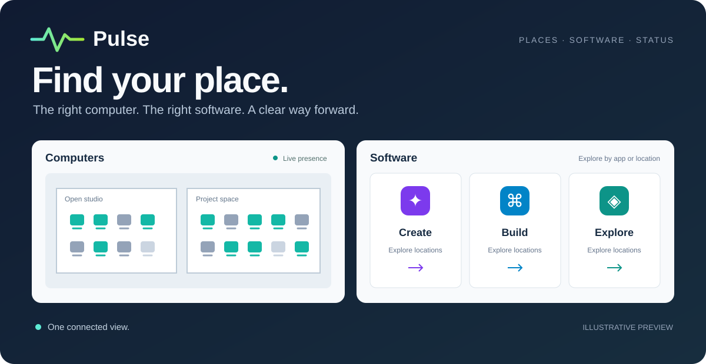

# A campus has a pulse. Make it visible.

The computer is somewhere. The software is installed somewhere. A service is down,
maintenance is coming, and someone needs to know before they walk across campus.

Pulse brings those answers together: live computer availability, a searchable software
catalog, and a shared view of service health. One product family, with focused experiences
for the people who use it.

  

  <a href="hub/README.md">Status hub</a> ·
  <a href="products/computers/README.md">Computers</a> ·
  <a href="products/software/README.md">Software</a> ·
  <a href="core/README.md">Build with Pulse</a>

The **Pulse hub** brings product summaries, active incidents, scheduled maintenance and
service history into one overview. See what is working, what needs attention and what is
changing before opening a product for the details.

Single sign-on and product audiences keep the overview relevant to each viewer. Your site
supplies the service catalog, incident updates and maintenance schedule.

**ComputersPulse** turns shared computers into a live view of your spaces. See what's
free, in use or offline. Explore a floorplan or scan the list. Filter for Mac or Windows
and find a seat before making the trip.

Small native agents report presence from managed computers. Inventory supplies the
devices and their recorded locations; your floorplans put them on the map.

**SoftwarePulse** starts with the application. Browse a curated icon grid, search by name,
or narrow the collection by platform and category. Expand an app to see its locations,
then send someone a dedicated link to the answer.

Prefer to start with a room? Switch to **Locations** and see its software collection.
Munki and Cimian manifests define the collection; ReportMate installation reports show
where those applications have been observed. Package icons bring the catalog to life.

**PrintersPulse** puts printers on the same floorplans as shared computers. Browse the
map or list to find a printer, then check its state, supplies, paper and queue in one place.

The interface and inventory catalog are implemented with sample status data. A collector
integration will connect the experience to the print-management system for real state.

**ServersPulse** brings server and service health into a focused view for IT staff. See
where a server runs, the services it supports, and its health, load and alerts without
losing the connection between infrastructure and the people who depend on it.

The current experience uses a sample health source. Planned collectors read existing
monitoring systems, cloud metrics and hypervisor APIs, with access set by product audience.

**WebsitesPulse** does the same for the organization's websites: where each one is hosted, whether
it answers, and the hosting facts that need attention, such as an out-of-date PHP version, a
plugin with a known vulnerability or a missed backup.

Health arrives as an hourly push from the site's data platform and as alerts from an uptime
service's webhook; the website list comes from the site's inventory.

## The product family

| Experience | What it answers | What's here today |
|---|---|---|
| [Hub](hub/README.md) | What's working? What's changing? | Product summaries, incidents, maintenance and service history |
| [ComputersPulse](products/computers/README.md) | Where is a computer free? | Live presence API, Mac and Windows agents, floorplans and list view |
| [SoftwarePulse](products/software/README.md) | Where can I use this application? | Curated software grid, location collections, shareable app links and installation snapshots |
| [PrintersPulse](products/printers/README.md) | Where can I print? | Interface and sample data; collector integration remains |
| [ServersPulse](products/servers/README.md) | Which services need attention? | Interface and sample health source; collector integration remains |
| [WebsitesPulse](products/websites/README.md) | Which websites need attention? | Health push and uptime-alert API, sample source and page |

## Connected by design

Pulse builds on the systems you already maintain:

- **Inventory → places.** Providers build the computer catalog from your inventory, so
  device identity and recorded location have an authoritative source.
- **Managed software → discovery.** Deployment manifests curate the software collection;
  installation evidence connects applications to locations.
- **Presence → availability.** Computer agents report state. Installation reports have
  their own freshness window; an available computer does not imply an available licence.
- **Products → one overview.** A shared summary contract gives the hub a consistent view
  across focused products.

Your deployment controls refresh schedules, source integrations and audience assignments.
A physical move appears when inventory is updated and the catalog is rebuilt.

## Make it yours

The application code is generic. Your deployment supplies the identity configuration,
hostnames, inventory mappings, floorplans and theme. Products can live on their own
subdomains—`computers.status.example.edu`, `software.status.example.edu`—with a hub at
`status.example.edu`.

The shared foundation includes a plain HTML/CSS/JavaScript web shell, Python APIs,
inventory providers and a reusable Azure Terraform module. Site-specific configuration
and credentials stay in a separate deployment repository.

Every shared masthead includes a lock button explaining page access on hover, focus or
click. Deployments supply `/access.json` with a `summary` and `groups`: each group has a
`name`, optional `description`, and optional `members` array of display names for an
expandable list. An optional `generated_at` timestamp dates those lists. Keep this file
behind the page's access rules when it contains member names. It describes the audience;
the site's authentication and role assignments enforce access.

| Start here | What you'll find |
|---|---|
| [Core](core/README.md) | Catalogs, inventory providers, event contracts and shared states |
| [Local computer demo](products/computers/README.md#run-it-locally) | Run the hub and computer experience with simulated presence |
| [Software integration](products/software/README.md) | Collection compilation, installation evidence and freshness |
| [Azure module](core/terraform/pulse-product) | Functions, Static Web Apps and storage infrastructure |
| [Hub configuration](hub/README.md) | Products, incidents, maintenance and history |

## License

MIT
